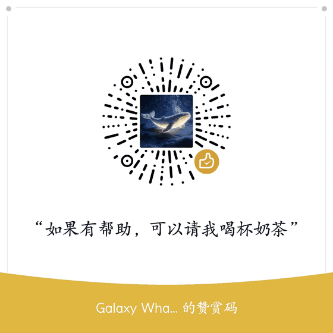

# 电商全网比价 Skill

|        |                     |
| ------ | ------------------- |
| **中文** | [English](#english) |

> **项目定位（请先读这一段）**  
> 这是为 **[DSH go](https://github.com/ccch1mneyyy/dsh-go/)** 做的一个**附属功能的开源项目**：把「让 AI 自动完成商品全网比价」这项能力，以一份可复用的 Skill（提示词 + 操作手册）形式沉淀下来，供 DSH go 及其他具备读屏能力的 AI Agent 参考使用。  
> 上游原仓库：**<https://github.com/ccch1mneyyy/dsh-go/>**  
> 上游 DSH go 是基于 **DeepSeek Harness** 的二次开发方向（其仓库标签含 `deepseek`、`deepseek-harness`）；本项目沿用的是同一类 Agent 能力语境，不含上游代码、也不隶属于上游。  
> **药品比价是其中的专项能力**：由作者与 **DeepSeek** 经过专项优化与调试，重点是**避免本想买「国药准字」的正规药品，却买成了食字号 / 妆字号 / 消字号（以及健字号、械字号）的别的产品**。
> 本项目**不是 DSH go 的官方组件**，不隶属于上游项目，也不包含、不复制上游的任何代码；它是一个独立发布、独立授权的方法论参考包。

**两个仓库（同一作者管理）**

- GitHub（主仓库）：<https://github.com/neurotracee/ecommerce-price-hunt>
- Gitee（国内镜像）：<https://gitee.com/bio234/ecommerce-price-hunt>

> 上面两个地址指向同一份代码，由**同一名作者**管理。GitHub 建得更早，Gitee 为国内访问更快的镜像。写这句是为了避免有人误以为其中一个是抄来的副本。

---

## 作者与制作方式（声明）

- **作者在创建本仓库时为初中生。** 需求定义、验收标准、创意与方向均由本人提出。
- **本项目的 Skill 提示词**，由 **DSH GO 的 deepseek 作者自购 API 的 DeepSeek V4.1 Flash 1017 版**，根据作者的反馈与实际模型表现进行处理与正式优化，最终总结归纳生成。
- **开源编写与仓库构建**：由 **腾讯 WorkBuddy 的 Hy4** 与 **DeepSeek V4.1 Flash 1017 版** 分别负责（**部分工作有具体的分工**，两个模型承担的角色不完全相同）。
- **作者本人负责**：指令下达、过程监督、结果反馈，以及提供创意想法与最终取舍。
- **仓库首个构建日期：2026 年 11 月。**

**关于维护节奏（提前说清楚）**：作者在创建本仓库时为初中生，具体情况不作解释。项目**刚发布的这段时间可能会比较频繁地更新与响应**；之后会转为**低频维护**——大约**一两个月看一两次** issue 与反馈，不承诺即时响应，也不承诺每个建议都会采纳。文档与坑位记录会尽量保持准确，但平台改版后可能需要等下一次查看才会补上。

## 授权与声明规范（二次开发 / 商用 / 借用前必读）

**本项目允许任何二次开发、商用或借用**，不需要付费、不需要申请、不需要等作者批准。

| 内容                                                                                  | 许可               | 说明                          |
| ----------------------------------------------------------------------------------- | ---------------- | --------------------------- |
| 文档与提示词（`README*`、`SKILL.md`、`references/`、`docs/`、`examples/`、`NOTICE.md` 等所有非代码文本） | **CC BY-SA 4.0** | 署名 + 标明修改 + 相同方式共享，**允许商用** |
| 代码与模板（`scripts/`、`assets/`）                                                         | **MIT**          | 允许商用、允许闭源衍生，需保留版权与许可声明      |

**两条硬要求，删掉任何一条都不合规：**

1. **必须标注源仓库地址，且两个地址都要写**，同时说明二者由同一作者管理：


   ```
   https://github.com/neurotracee/ecommerce-price-hunt
   https://gitee.com/bio234/ecommerce-price-hunt
   （以上两个仓库由同一作者管理；GitHub 为主仓库，Gitee 为国内镜像）
   ```
2. **必须注明是否修改**；改过的版本要写明「已修改」，且不得暗示原作者为你的版本背书。

文档类衍生作品还须以 **CC BY-SA 4.0**（或兼容许可）发布——这是 ShareAlike 条款本身的要求。  
完整条款、可复制的署名块、以及「地址写在哪里算数」：见 [`NOTICE.md`](NOTICE.md) 与 [`LICENSE-DOCS.md`](LICENSE-DOCS.md)。

> ⚠️ **协议 ≠ 用途。** 授权放开的是版权层面的使用方式（能不能改、能不能商用、能不能再分发），**不是**对使用场景的免责。  
> 下文的「使用边界」与 `SKILL.md` 的硬规则**依然有效**：不得群控 / 刷单 / 抢购 / 批量爬取 / 抓取个人信息，  
> 不得绕过验证码、风控、应用锁，比价结果不得用于药品广告、价格宣传、诊疗建议或对外发布的比价榜单。

---

## 📦 安装：把压缩包下载下来 → 直接发给 DSH → 一句话装好

**不用 clone 仓库，不用敲命令，也不用在本页翻上翻下找说明。**

**第 1 步｜直接把压缩包下载下来**（技能安装包 `ecommerce-price-hunt-v1.4.0.zip`）：

- GitHub：<https://github.com/neurotracee/ecommerce-price-hunt/releases/download/v1.4.0/ecommerce-price-hunt-v1.4.0.zip>
- Gitee（国内更快）：<https://gitee.com/bio234/ecommerce-price-hunt/releases/download/v1.4.0/ecommerce-price-hunt-v1.4.0.zip>

**第 2 步｜把 zip 交给 DSH**：最稳的是把上面下载到的**文件本身**直接拖进对话框，或作为附件上传；也可以把下载链接发给它、让它自己取（见下方说明）。

> 💡 **两条路都行：手动下载更稳，直接发链接也可以试。**
> - **推荐**：自己把 zip 下载下来，再把**文件本身**发给 AI（拖进对话框，或作为附件上传）。
> - **也可以**：直接把下载链接发给 AI，让它自己去取。能不能顺利取到，**取决于你用的 AI 宿主能力和当时的网络环境**——有的宿主能自己打开链接、把文件存下来；有的会卡在登录墙、跳转中转页、平台限流、需要人机验证，或者读不到页面内容。这种情况下反复重试，确实会白花时间和 token。**这因人而异，没有一刀切的结论。**
> - 实操建议：优先给文件；手头不方便下载时，先发链接试试，一旦发现它卡住了（开始重复跳转、重复失败），就停下、改为手动下载再把文件发过去，别让它一直重试。

**第 3 步｜对它说这一句**（可直接复制）：

> 帮我安装它到本地目录即可，我要把它添加进来。

DSH 会自己解压、把 `ecommerce-price-hunt/` 放进本地技能目录，装完把路径告诉你。之后直接说「开始针对〈品牌 商品 规格〉做全网比价，出 HTML 报告，我收货地在〈省 市〉」就能触发本 Skill。

> ⭐ **用着顺手的话，回来点一颗 Star 就是最实在的回报**——不花钱，比打赏更有用，别人才搜得到。
> [GitHub 点 Star](https://github.com/neurotracee/ecommerce-price-hunt) · [Gitee 点 Star](https://gitee.com/bio234/ecommerce-price-hunt)
> 两个仓库的 Star 各算各的，**从哪边看到都建议顺手去另一边也点一颗**（对作者是鼓励，也让更多人发现它）；赞赏码在文末，完全自愿。

---


> **开源协议（文字版，不依赖徽章图片）**：文档与提示词 **CC BY-SA 4.0**（署名 + 标明修改 + 相同方式共享，**允许商用**）；代码与模板 **MIT**。任何二次开发、商用、借用均可，但必须标注上面两个仓库地址并说明同一作者管理。详见 [`NOTICE.md`](NOTICE.md)。

---

## ⚠️ 免责声明（与 `SKILL.md` 保持一致，原文收录）

> **用途声明**  
> 本项目是一份「比价作业指导书」：**只有提示词和操作手册，不含任何自动化脚本、破解工具或接口逆向代码**。设计给个人在自有设备上、用自己的账号、以人工浏览的方式核对价格使用。**禁止**用于群控、刷单、抢购、批量爬取、抓取个人信息、对外商业比价服务或价格宣传。本项目**不绕过**验证码、风控、应用锁或加密接口；遇到这些一律回到人工。仅供学习与个人研究，**不构成法律意见**，商用或大范围传播前请自行咨询律师。

> **【药品专项】用途限制**（摘自 `SKILL.md`，目标为药品时强制生效）
>
> - 比价结果仅供个人参考；**不得用于药品广告、价格宣传、诊疗建议，也不得据此发布对外比价榜单**。
> - 本技能的输出仅供个人参考：**不得用于药品广告、价格宣传、诊疗建议或对外发布的比价榜单**；药品购买与使用请遵医嘱或药师指导。
> - 闸门三条件：国药准字 + 字母 + 8 位数字；有 OTC 或 RX 标识；剂型与通用名对得上。三者齐全才进表；查不到文号写「未核实」，不编造。

> 本项目仅提供比价方法，不构成用药、购买或投资建议；价格信息具有时效性，作者不对因使用本项目产生的任何直接或间接损失负责。请遵守各平台用户协议与相关法律法规。

---

## 这是什么

一个给 AI Agent 用的**比价方法论**：让 Agent 通过手机/浏览器的**无障碍读屏**，逐个平台查看同一个商品的真实到手价、发货地与时效，最后产出一份双屏（手机 + 笔记本）自检过的 HTML 报告。

**不是**爬虫库，**不是**价格 API，**不是**自动化脚本。它是**提示词 + 操作手册**，靠 Agent 自身的 UI 操作能力落地。仓库里没有可执行的价格采集代码，也不会有。

它的目标是让 Agent 在做比价时**少走弯路**：先判品类、再定口径、按需加载手册、最后按固定结构交付，避免「看首屏就下结论」「把标价当实付」「不同规格混算」「把妆字号当药」这类反复返工的错误。返工少了，token 消耗、来回对话轮次和等待时间自然就降下来了。

## 为什么需要一个 Skill，而不是让 Agent 自由发挥

| Agent 常见误区    | 本 Skill 的约束                            | 省下的是什么          |
| ------------- | -------------------------------------- | --------------- |
| 只看搜索首屏就报「最低价」 | 每平台至少 3–5 屏，多店对比；详情页继续滚；查不到就进结算页看规格    | 避免结论被推翻后整轮重来    |
| 把标价当到手价       | 实付 = 标价 + 运费 − 可叠加券，券门槛必须写明            | 避免算错后重新采集全部平台   |
| 不同规格直接比数字     | 统一换算元/克、元/ml、元/片；多件装先折单件；不同规格绝不混算      | 避免整张表作废         |
| 药品/化妆品/保健食品混表 | 第 0 步先判品类，药品启用国药准字闸门，默认排除妆/食/健/消/械字号   | 避免输出不可用甚至有风险的结果 |
| 把所有手册一次性塞进上下文 | 「按需加载」表：首次做某平台 / 读不到屏幕 / 换算 / 写报告，各读各的 | 直接减少每轮的输入 token |
| 报告结构每次都重新设计   | 固定 10 章节 + 全量清单列定义 + 双屏自检清单            | 省掉反复改版式与反复截图    |
| 读不到就猜一个数字     | 不猜数据；读不到写进「局限」；推断与实测分开写                | 避免幻觉引发的信任成本     |
| 遇到应用锁/验证码还硬闯  | 一律 `handoff` 交还用户，不绕过                  | 避免卡死、避免违规       |

一句话：**把踩过的坑写成闸门，把重复劳动写成模板，把长手册拆成按需加载**。这是本项目对「提升 AI 能力 / 减少 token 与时间浪费」的全部主张，不做效果数字的承诺。

## 装好之后怎么用

直接说：

> 开始针对「某品牌 某商品 某规格」做全网比价，出 HTML 报告，我收货地在××省××市。

Agent 会先判品类（普通商品 / 药品 / 化妆品 / 保健食品 / 医疗器械），再逐平台采集，最后交付 HTML 报告。更多触发话术在 `examples/prompt-examples.md`。

## 手动安装（用 DSH go 时不需要）

只有在换到别的 Agent 宿主、或想自己动手时才需要。DSH go / 具备 `~/.dsh/skills` 约定的宿主：

```bash
mkdir -p ~/.dsh/skills
cp -r ecommerce-price-hunt ~/.dsh/skills/
```

其他 Agent 平台（Claude Code、WorkBuddy、自定义 Harness 等）按各自的 skill / prompt 目录约定放置；没有技能机制时，把 `SKILL.md` 当系统提示词，`references/*.md` 按「按需加载」表注入即可。详见 [docs/portability.md](docs/portability.md)。

> **报告排版不依赖宿主**：HTML 与可视化能力已**随包内置**在 `vendor/` 里（`answer-visualization-preference` 与 `HTML & Visualization` 两个技能），写 HTML 前必须用**相对路径**同时读这两个技能；图表分支再按需读第三个（`ai-visualization`）。换机器、换宿主都能直接跑，不写死任何绝对路径。详见 [`vendor/README.md`](vendor/README.md)。

## 前置条件

1. **UI 操作能力**：手机无障碍（或等价的屏幕树 / 截图能力），能点、能滚、能读。
2. **读图能力**：部分 App 详情页只能用图片渲染，需要能读图的模型。
3. **HTML 与可视化技能**：已随包内置（`vendor/`），无需另装；只有在 `vendor/` 缺失时才退回按 `references/report-spec.md` 自行实现。

## 它能做什么

- 跨平台比价：京东、拼多多、淘宝（网页版）、抖音商城、快手商城、美团买药，可按需扩展。
- 口径统一：全部换算成**元/克、元/ml、元/片**再比，避免被「大瓶便宜」误导。
- 算实付：标价 + 运费 − 券，写明满减 / 首单 / 新人 / 地区门槛；标价最低 ≠ 实付最低。
- 前 N 名深挖（默认 3）：发货地、默认快递、发货承诺、到货预估，能问客服就问并保留原话。
- 药品专项：只认「国药准字 + OTC/RX」，默认排除妆字号 / 食字号 / 健字号 / 消字号 / 械字号。
- 交付报告：单文件 HTML，按**实际设备的手机与桌面视口**分别自检——视口尺寸现场探测（命令查屏幕 / 按机型查资料），不写死任何比例或像素。
- **版本自检**：每次任务交付后，在结尾追加一行版本状态（当前 / 最新 / 是否落后）；落后时说明差距、用一两句话讲清改了什么，并问你是否一键升级（规则见 `SKILL.md` 末尾）。

## 目录结构

```
ecommerce-price-hunt/
├── README.md                      # 中英双语说明（中文在上，英文在下）
├── README.en.md                   # 指向 README.md 英文小节的入口（保留旧链接）
├── SKILL.md                       # 入口：品类判定、采集流程、口径、药品专项、硬规则
├── LICENSE                        # 代码与模板：MIT
├── LICENSE-DOCS.md                # 文档与提示词：CC BY-SA 4.0（含法律全文）
├── NOTICE.md                      # 授权与署名规范（硬要求）、DSH go 归属声明
├── CHANGELOG.md / CONTRIBUTING.md / CODE_OF_CONDUCT.md / SECURITY.md
├── CITATION.cff                   # 引用信息
├── references/
│   ├── platform-playbooks.md      # 各平台入口 / 排序 / 标签位置 / 已知坑
│   ├── screen-reading.md          # 读屏快路、坑与对策、误点防护、数据落地格式
│   ├── pricing-method.md          # 单价换算、实付公式、券门槛、风险标记
│   └── report-spec.md             # 报告 10 章节、视口探测、自检清单
├── vendor/                        # 随包内置的可视化 / HTML 技能（写报告前必读）
│   ├── answer-visualization-preference/SKILL.md
│   ├── html-visualization/html/   # 含 scripts/shot.py 双屏自检
│   └── html-visualization/ai-visualization/  # 图表/图解分支，按需加载
├── assets/report-skeleton.html    # 只含比价章节的骨架（示例数据全部虚构）
├── docs/                          # 设计说明、平台移植、FAQ
├── examples/                      # 触发话术与一次任务的流程示例（无真实数据）
├── images/wechat-donate.png       # README 用的微信赞赏码（不打进安装包）
├── scripts/                       # 结构校验、打包、一键同步发布
└── .github/                       # Issue / PR 模板、CI 校验
```

## 使用边界（禁止用途）

不允许，也不在能力范围内：

- 群控、自动化养号、刷单、刷评、抢购、秒杀、代下单；
- 批量爬取商品 / 评论 / 用户数据，或抓取任何个人信息；
- 绕过验证码、风控、应用锁、人脸 / 指纹验证、加密参数或 undocumented 接口；
- 把比价结果做成对外发布的比价榜单、价格宣传、药品广告或投资 / 诊疗建议；
- 高频轮询、无人值守循环、多账号并发。

单次任务建议不超过 30 条链接、≤3 个平台深挖；只记录比价必需字段，个人信息不落盘。完整硬规则见 `SKILL.md`。

> 这些边界属于**使用规范**，与上面的**版权授权**是两件事：授权允许你把项目拿去商用，但不允许用它做上述行为。

**技能自己也会守这条线**：遇到越界请求（群控、刷单、抢购、批量爬取、绕过验证码或风控等），它会**直接拒绝、只给合规替代，不提供任何变通或「换个说法」的方案**，并附一句风险提示——这类操作可能违反平台协议与相关法律，**是否继续由使用者自行判断并承担后果，与本项目及作者无关**。

## 设计取舍

- **不做自动化抓取**：走真实 App UI，价格与活动（大促、百亿补贴、券后）都能看到；代价是慢，且强依赖设备状态。
- **不猜数据**：读不到就写进「局限」；查不到的批准文号标「未核实」。
- **不越界**：应用锁、登录、验证码、支付一律交还用户；结算页只看到价格为止，不提交订单。
- **不绑定宿主**：报告样式、组件、图表与双屏自检全部来自随包的两个可视化/HTML 技能（`vendor/`），换宿主不用改配置。

## 已知限制

- 价格随活动变化，报告里的到手价要连采集时间一起看。
- 部分平台发货地不公示、部分网页版无客服入口，这类信息只能标缺失。
- 平台改版会让入口与元素失效，`platform-playbooks.md` 需要随之更新。
- 平台用户协议通常禁止自动化获取数据；使用者需自行确认自身行为是否合规。

## Release 与版本

每个版本都会发布一个**可直接放进技能目录的 zip**，并在 Release 正文里重复作者声明、授权规范与完整免责声明。Gitee 镜像仓库同步发布。版本号遵循语义化版本，`SKILL.md` 的行为变更会写进 `CHANGELOG.md`。

装好之后，技能会**自己在每次任务结尾报告版本**（当前版本 · 远端最新 · 是否最新）；如果落后，会顺带说明差距与主要改动，并问你要不要升级——**检查永远放在任务做完之后**，不会占用比价本身的时间与 token。

## 贡献

欢迎补充平台实录、修正坑位、翻译与文档改进。请读 [CONTRIBUTING.md](CONTRIBUTING.md)：**不要**提交真实品牌 / 真实价格 / 真实店铺数据、个人信息、爬虫或绕过类代码。提交即表示同意以本项目同款许可（文档 CC BY-SA 4.0 / 代码 MIT）发布你的贡献。

## 许可

> ⚠️ **关于平台侧栏显示的许可证**：侧栏那个标签是平台**自动识别**的结果，不能代表整个项目的授权。GitHub 多半显示 **MIT**（它只读 `LICENSE`），Gitee 可能显示 **CC BY-SA 4.0**（它按内容判断）——两者都只说对了一半：**代码与模板是 MIT**（`scripts/`、`assets/`、`LICENSE`），**文档与提示词是 CC BY-SA 4.0**（`README*`、`SKILL.md`、`references/`、`docs/`、`examples/`、`NOTICE.md`，以 `LICENSE-DOCS.md` 为准）。以本文件与 `NOTICE.md` 的说明为准。

- **文档与提示词**：[CC BY-SA 4.0](LICENSE-DOCS.md)（署名 + 标明修改 + 相同方式共享，**允许商用**）。
- **代码与模板**：[MIT](LICENSE)。
- **必须署名**：两个仓库地址都要写，并说明同一作者管理，写法见 [`NOTICE.md`](NOTICE.md)。
- 本项目为**开源项目**（文档符合 CC 的自由文化作品定义，代码符合 OSI 的 MIT），此前版本曾使用含非商业条款的 CC BY-NC-SA 4.0，自 v1.2.0 起改为 CC BY-SA 4.0 并明确允许商用。

上游 [DSH go](https://github.com/ccch1mneyyy/dsh-go/) 采用 AGPL-3.0；本项目不包含其代码，为独立作品、独立授权，也不代表上游项目立场。

---

## ⭐ 支持本项目（点个 Star + 赞赏）

**点一颗 Star，比打赏更有用。**

不想花钱完全没问题：点一颗 **Star** 就是最好的支持——Star 多了，别人才搜得到，作者也更有动力继续更新平台手册和坑位记录。

> 🔁 **小请求：不管你是从哪个仓库看到这个项目的，都顺手到对面那个仓库也点一颗 Star。**
> 两个仓库的 Star 数、搜索权重和推荐位是**各自独立**的：在 GitHub 点了，Gitee 那边的访客看不到；在 Gitee 点了，GitHub 那边也不涨。两边各点一下等于帮这个项目多开一扇门——既是对作者的鼓励，也能让更多正在找比价方法的人发现它。当然，只点一边也完全没问题，方便为先。

- GitHub 点 Star：<https://github.com/neurotracee/ecommerce-price-hunt>
- Gitee 点 Star：<https://gitee.com/bio234/ecommerce-price-hunt>

如果这个 Skill 确实帮你少烧了 token、少返工了几轮，也可以扫码请作者喝杯奶茶 🧋——**完全自愿**，不打赏一样免费、功能不缺、更新照常。



> - **赞赏是纯粹的个人自愿打赏**，不是购买、不是订阅、不附带任何服务承诺，也不影响授权：本项目仍按上面的 CC BY-SA 4.0 / MIT 授权，**商用、二次开发、借用都不需要付费，也不需要经过作者同意**。
> - 想把二维码存下来：在图片上右键「图片另存为」即可（仓库内路径 `images/wechat-donate.png`）。
> - 若图片没显示（部分镜像/离线阅读器会屏蔽外链图片），到仓库页面 `images/wechat-donate.png` 直接打开即可。

---

**再次提示**：本项目仅供学习与研究参考，不构成法律、用药、购买或投资建议。完整免责声明见本文开头与 `SKILL.md`。

---

# English

|                     |             |
| ------------------- | ----------- |
| [中文](#电商全网比价-skill) | **English** |

> **Positioning — read this first**  
> This is an **open-source project for an ancillary feature built for [DSH go](https://github.com/ccch1mneyyy/dsh-go/)**. It packages the "let an AI automatically compare product prices across stores" capability as a reusable Skill (prompts + operating playbooks), for DSH go and other AI Agents with screen-reading ability.  
> Upstream repository: **<https://github.com/ccch1mneyyy/dsh-go/>**  
> Upstream DSH go follows the **DeepSeek Harness** development direction (its repository topics include `deepseek` and `deepseek-harness`). This project shares that Agent-capability context but contains no upstream code and is not affiliated with it.  
> This project is **not an official DSH go component**, contains or copies **no upstream code**, and is independently published under its own license.
> **Medicine comparison is a specialisation inside it**: optimised and debugged by the author together with **DeepSeek**, with the focus on **not ending up with a food-, cosmetic- or hygiene-licence product (食字号 / 妆字号 / 消字号, also 健字号 / 械字号) when what you actually wanted was a proper 国药准字 medicine**.


**Two repositories, one author**

- GitHub (main): <https://github.com/neurotracee/ecommerce-price-hunt>
- Gitee (mainland-China mirror): <https://gitee.com/bio234/ecommerce-price-hunt>

> Both addresses point to the same codebase and are managed by the **same author**. The GitHub repository was created first; Gitee is a faster mirror for mainland China. This note exists so nobody mistakes one for a copy of the other.

---

## Author & how it was made

- **The author was a junior high school student when this repository was created.** Requirements, acceptance criteria, creative direction and final decisions were all set by the author.
- **The Skill prompts** were processed and formally optimised by **the DeepSeek V4.1 Flash 1017 build, using an API key purchased by the DSH GO deepseek author**, based on the author's feedback and the actual behaviour of the model, and finally summarised and consolidated into the text you see here.
- **Open-source writing and repository construction** were handled respectively by **Hy4 on Tencent WorkBuddy** and **DeepSeek V4.1 Flash 1017** — the two models had **partly different, specifically divided roles**.
- **The author was responsible for** issuing instructions, supervising the process, giving feedback, and providing the creative ideas.
- **First repository build date: November 2026.**

**On maintenance pace (stated up front)**: the author was a junior high school student when this repository was created; the specific circumstances are not something this README explains. Expect **fairly frequent updates right after the initial release**, then **low-frequency maintenance — roughly one or two looks a month**. There is no promise of a fast reply, and no promise that every suggestion will be adopted. The playbooks and pitfall notes aim to stay accurate, but after a platform redesign they may not be corrected until the next check.

## License & attribution rules (read before forking or commercial use)

**Any secondary development, commercial use or reuse is permitted** — no payment, no application, no waiting for approval.

| Content | License | Notes |
| --- | --- | --- |
| Documentation and prompts (`README*`, `SKILL.md`, `references/`, `docs/`, `examples/`, `NOTICE.md`, all other non-code text) | **CC BY-SA 4.0** | Attribution + indicate changes + ShareAlike; **commercial use allowed** |
| Code and templates (`scripts/`, `assets/`) | **MIT** | Commercial use and closed-source derivatives allowed; keep the copyright and permission notice |

**Two hard requirements — dropping either one is non-compliant:**

1. **You must cite the source repository URLs — both of them** — and state that the two repositories are managed by the same author:

   ```
   https://github.com/neurotracee/ecommerce-price-hunt
   https://gitee.com/bio234/ecommerce-price-hunt
   (both repositories are managed by the same author; GitHub is the main repo, Gitee the mainland-China mirror)
   ```

2. **You must state whether you modified it.** Modified versions must say so clearly and must never imply that the original author endorses your version.

Derivative documentation must also be released under **CC BY-SA 4.0** (or a compatible license) — that is the ShareAlike condition itself.
Full terms, copy-paste attribution blocks and "where the notice counts": see [`NOTICE.md`](NOTICE.md) and [`LICENSE-DOCS.md`](LICENSE-DOCS.md).

> ⚠️ **A license is not permission for any use case.** What the license grants is copyright permission (may you modify, sell, redistribute). It does **not** waive the usage boundaries below or the hard rules in `SKILL.md`: no device farms, fake orders, flash-sale bots, bulk scraping or personal-data harvesting; no bypassing CAPTCHAs, risk controls or app locks; results must not be used for medicine advertising, price promotion, treatment advice or published price rankings.

---

## 📦 Install: download the zip → hand it to DSH → one sentence

**No cloning, no terminal commands, no jumping up and down this page.**

1. **Download the zip** (`ecommerce-price-hunt-v1.4.0.zip`):
   - GitHub: <https://github.com/neurotracee/ecommerce-price-hunt/releases/download/v1.4.0/ecommerce-price-hunt-v1.4.0.zip>
   - Gitee (faster in mainland China): <https://gitee.com/bio234/ecommerce-price-hunt/releases/download/v1.4.0/ecommerce-price-hunt-v1.4.0.zip>
2. **Hand the zip to DSH** — the safest route is to drag the **file** you just downloaded into the chat, or attach it; alternatively paste the download link and let it fetch the file (see the note below).
   > 💡 **Both routes work: downloading by hand is the safer bet, pasting the link is worth a try.**
   > - **Recommended:** download the zip yourself and send the **file** (drag it in, or attach it).
   > - **Also fine:** paste the download link and let the AI fetch it. Whether that works **depends on your AI host and your network at that moment** — some hosts open the link and save the file on their own; others stall on a login wall, a redirect interstitial, platform rate limiting, a human-verification check, or simply cannot read the page. Retrying in that situation really does burn time and tokens. **It varies from setup to setup; there is no one-size-fits-all rule.**
   > - Rule of thumb: give the file when you can; if downloading is inconvenient, try the link first, and as soon as it starts looping (repeated redirects, repeated failures), stop and fall back to a manual download instead of letting it retry.
3. Say this one line (copy as-is; the prompt is in Chinese because DSH is a Chinese-language client):

   > 帮我安装它到本地目录即可，我要把它添加进来。

   *("Install it into my local directory for me — I want to add it in.")* DSH unzips it into the local skills folder and reports the path.

> ⭐ **If it works well for you, a Star is the most useful way to say thanks** — it costs nothing, helps more people find the project, and beats a tip.
> [Star on GitHub](https://github.com/neurotracee/ecommerce-price-hunt) · [Star on Gitee](https://gitee.com/bio234/ecommerce-price-hunt)
> The two repositories count stars separately, so **whichever side you are on, please also star the other one** (it encourages the author and helps others discover it). The tip QR is at the end of this section — entirely optional.

> **License (plain text, in case badge images do not load)**: documentation and prompts are **CC BY-SA 4.0** (attribution, indicate changes, share-alike, **commercial use allowed**); code and templates are **MIT**. Any secondary development, commercial use or reuse is allowed, provided you cite **both** repository URLs above and state that one author manages them. See [`NOTICE.md`](NOTICE.md).

---

## ⚠️ Disclaimer (mirrors `SKILL.md`; the Chinese text there is authoritative)

> **Statement of purpose**
> This project is a **comparison work instruction**: prompts and operating playbooks only, with **no automation scripts, no cracking tools and no reverse-engineered API code**. It is designed for an individual using their own device, their own account, and human-paced browsing. **Do not** use it for device farms, fake orders, flash-sale bots, bulk scraping, harvesting personal data, commercial price-comparison services, or price advertising. It does **not** bypass CAPTCHAs, risk controls, app locks or encrypted endpoints — hand control back to the user instead. For learning and personal research only; **not legal advice**. Consult a lawyer before commercial use or wide distribution.

> **Medicine-specific use restriction** (from `SKILL.md`, mandatory when the target is a medicine)
> - Results are **for personal reference only**; **they must not be used for medicine advertising, price promotion, diagnostic or treatment advice, or for publishing public price-comparison rankings**.
> - Purchasing and using medicines must follow a physician's or pharmacist's guidance.
> - Gate: an NMPA approval number (国药准字 + letter + 8 digits), an OTC/RX marking, and a dosage form matching the generic name — all three must be present; unverifiable approval numbers are recorded as "unverified", never invented.

> This project provides a method only. It is not medical, purchasing or investment advice. Prices are time-sensitive; the author accepts no liability for any loss arising from its use. Comply with each platform's terms of service and applicable law.

---

## What it is

A **methodology for AI Agents**: using accessibility-based screen reading on a phone or browser, an Agent visits each platform, records the real out-of-pocket price, shipping origin and delivery estimate, then produces a single-file HTML report self-checked on two viewports (phone + laptop) measured from the user's real device, never from hard-coded pixel sizes.

It is **not** a crawler library, **not** a price API, **not** an automation script. There is no price-collection code in this repository and there never will be.

## Why a Skill instead of letting the Agent improvise

| Common Agent mistake | Constraint in this Skill | What it saves |
| --- | --- | --- |
| Reports "lowest price" from the first screen | 3–5 screens per platform, multiple shops, keep scrolling in detail pages, check the checkout page for specs | Avoids redoing the whole run after the conclusion breaks |
| Treats list price as final price | Final = list price + shipping − stackable coupons, with coupon conditions recorded | Avoids re-collecting every platform |
| Compares different package sizes directly | Normalise to ¥/g, ¥/ml, ¥/tablet; split multi-packs; never mix specs | Avoids scrapping the whole table |
| Mixes medicines with cosmetics / supplements | Step 0 category gate; medicine gate for 国药准字, exclude 妆/食/健/消/械 by default | Avoids unusable or risky output |
| Dumps every playbook into context | On-demand loading table per scenario | Directly cuts input tokens per turn |
| Redesigns the report every run | Fixed 10 sections + column definitions + viewport-probing checklist | Cuts layout iterations and screenshot rounds |
| Guesses a number when the screen can't be read | No guessing; log it under "limitations"; separate inference from observation | Avoids hallucination and trust cost |
| Pushes past app locks / CAPTCHAs | Always hand off to the user; never bypass | Avoids dead ends and policy violations |

In short: **turn known pitfalls into gates, repeated work into templates, and long manuals into on-demand loads.** No quantitative efficiency claims are made.

## After installing

Say: *"Run a cross-platform price comparison for ⟨brand + product + spec⟩, give me an HTML report, my delivery address is in ⟨city⟩."* More trigger phrases are in `examples/prompt-examples.md`.

## Manual install (not needed with DSH go)

Only for other hosts or for doing it by hand:

```bash
mkdir -p ~/.dsh/skills
cp -r ecommerce-price-hunt ~/.dsh/skills/
```

For other hosts (Claude Code, WorkBuddy, custom harnesses), follow their own skill / prompt directory convention; without a skill mechanism, use `SKILL.md` as a system prompt and inject `references/*.md` per the on-demand table. See [docs/portability.md](docs/portability.md).

> **Report layout does not depend on the host**: the HTML and visualisation skills are **bundled** under `vendor/` (`answer-visualization-preference` and `HTML & Visualization`). Before writing any HTML you must read both of them, **using relative paths only**; the chart/graphic branch additionally loads the third one (`ai-visualization`) on demand. Nothing is hard-coded to a machine-specific absolute path. See [`vendor/README.md`](vendor/README.md).

## Layout

```
README.md                    bilingual (Chinese first, English below)
README.en.md                 pointer to the English section (kept for old links)
SKILL.md                     entry point: category gate, collection flow, pricing rules, medicine gate, hard rules
LICENSE                      MIT — code and templates
LICENSE-DOCS.md              CC BY-SA 4.0 — documentation and prompts (full legal text)
NOTICE.md                    license & attribution rules, DSH go provenance
references/*.md              on-demand playbooks (platforms, screen reading, pricing math, report spec)
assets/report-skeleton.html  section skeleton only; all sample numbers are fictional
vendor/                      bundled visualisation / HTML skills (must be read before writing the report)
docs/ examples/ scripts/     design notes, usage examples, validation / packaging / publishing
images/wechat-donate.png     the WeChat tip QR shown in this README (not packed into the zip)
.github/                     issue & PR templates, CI validation
```


## Prohibited uses

Device farms, account farming, fake orders/reviews, flash-sale bots, bulk scraping, harvesting personal data, bypassing CAPTCHA / risk control / app locks / biometric checks / undocumented endpoints, public price rankings, medicine advertising, price promotion, investment or treatment advice, high-frequency polling, unattended loops, concurrent multi-account operation.

Recommended ceiling: ≤30 links and ≤3 deeply-examined platforms per task. Record only comparison-required fields; never persist personal information.

> These are **usage rules**, distinct from the **copyright license** above: the license lets you use this project commercially; it does not let you do any of the things listed here.

**The Skill enforces this line itself**: on an out-of-scope request (device farms, fake orders, flash-sale grabbing, bulk scraping, bypassing CAPTCHAs or risk controls), it **refuses outright, offers only compliant alternatives, and never supplies workarounds or a reworded route to the same thing** — plus one risk notice: such actions may breach platform terms and the law, and **whether to proceed is the user's own decision and responsibility, unrelated to this project or its author**.

## Releases

Each release ships a ready-to-install zip and repeats the author statement, the license & attribution rules and the full disclaimer in its notes. Mirrored on Gitee. See [CHANGELOG.md](CHANGELOG.md).

Once installed, the Skill reports its own version at the end of every task (current · latest · up to date or not). If it is behind, it states the gap and a one-or-two-sentence summary of what changed, then asks whether to upgrade — **the check always runs after the task is delivered**, so it never eats the time or tokens spent on the comparison itself.

## Contributing

Platform observations, pitfall corrections, translations and documentation improvements are welcome. Read [CONTRIBUTING.md](CONTRIBUTING.md): do **not** submit real brands, real prices, real shop data, personal data, scrapers or bypass code. By contributing you agree to release your contribution under the same licenses (docs CC BY-SA 4.0 / code MIT).

## License

> ⚠️ **About the license shown in the platform sidebar**: that label is an **auto-detection** result and does not represent the whole project. GitHub will usually show **MIT** (it only reads `LICENSE`); Gitee may show **CC BY-SA 4.0** (it guesses from content). Each is only half the story: **code and templates are MIT** (`scripts/`, `assets/`, `LICENSE`), while **documentation and prompts are CC BY-SA 4.0** (`README*`, `SKILL.md`, `references/`, `docs/`, `examples/`, `NOTICE.md`; see `LICENSE-DOCS.md`). This file and `NOTICE.md` are authoritative.

- **Documentation and prompts**: [CC BY-SA 4.0](LICENSE-DOCS.md) (attribution, indicate changes, share-alike, **commercial use allowed**).
- **Code and templates**: [MIT](LICENSE).
- **Attribution is mandatory**: cite both repository URLs and state that one author manages them — exact wording in [`NOTICE.md`](NOTICE.md).
- This is an **open-source project** (the documentation meets the CC definition of a free cultural work; the code meets OSI's MIT). Earlier versions used CC BY-NC-SA 4.0 with a non-commercial clause; from v1.2.0 it is CC BY-SA 4.0 with commercial use explicitly allowed.

Upstream [DSH go](https://github.com/ccch1mneyyy/dsh-go/) is AGPL-3.0. This project contains none of its code, is an independent work under its own license, and does not speak for the upstream project.

---

## ⭐ Support this project (star it + optional tip)

**A star beats a tip.**

If you don't feel like paying anything, that's completely fine: a **star** is the best support — more stars mean more people find the project, and it keeps the author motivated to update the platform playbooks and pitfall notes.

> 🔁 **One small request: whichever repository you found this project on, please also drop a star on the other one.**
> The two repositories count stars, search ranking and recommendations **completely independently**: a star on GitHub is invisible to visitors on Gitee, and vice versa. Starring both opens one more door for the project — it encourages the author and helps more people who are looking for a comparison method actually find it. Of course, one star alone is perfectly fine too — convenience comes first.

- Star on GitHub: <https://github.com/neurotracee/ecommerce-price-hunt>
- Star on Gitee: <https://gitee.com/bio234/ecommerce-price-hunt>

If this Skill genuinely saved you tokens and re-runs, you can also scan the QR code to buy the author a bubble tea 🧋 — **entirely voluntary**. No tip means no difference: it stays free, nothing is locked, and updates keep coming.


> - **A tip is a purely voluntary personal gift.** It is not a purchase, not a subscription, carries no service commitment, and does not affect the license: the project remains **CC BY-SA 4.0 / MIT**, and **commercial use, secondary development and reuse never require payment or the author's permission**.
> - To keep the QR code: right-click the image and choose "Save image as" (path in the repository: `images/wechat-donate.png`).
> - If the image does not render (some mirrors and offline readers block remote images), open `images/wechat-donate.png` directly from the repository page.

---

For learning and research reference only. Full disclaimer at the top of this file and in `SKILL.md`.
